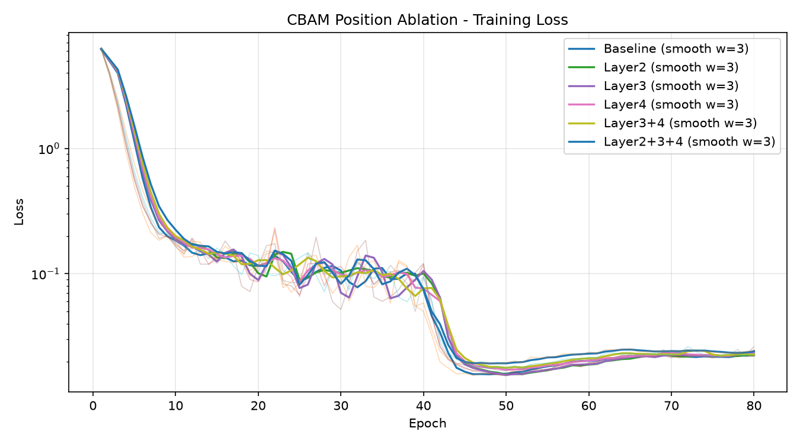
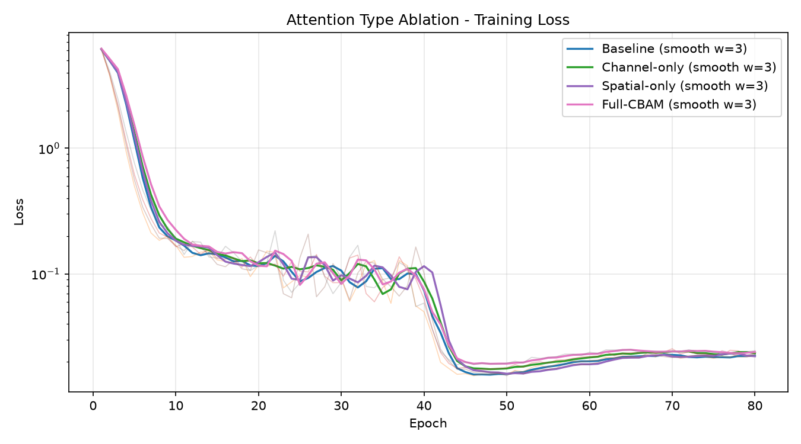
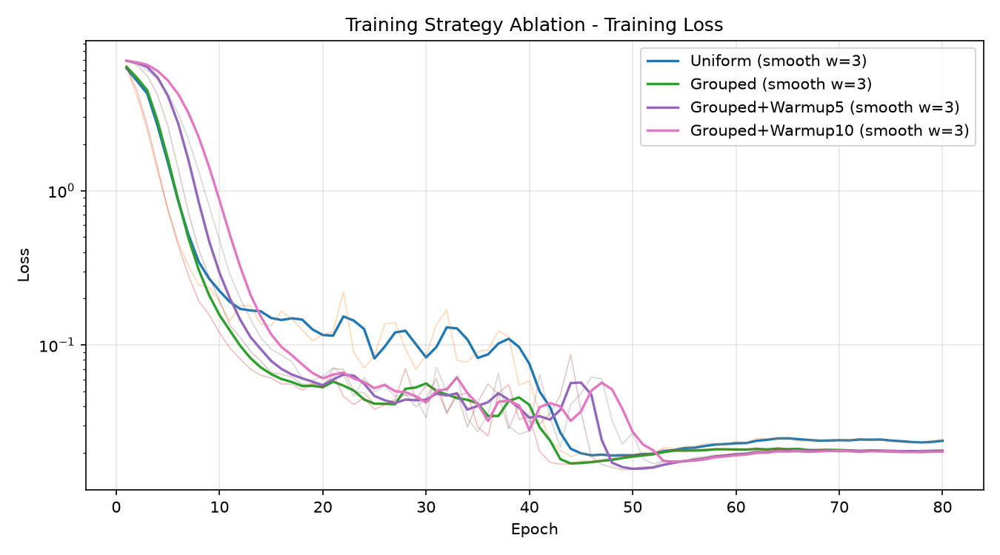

# ResNet-50 CBAM Re-ID 消融实验报告

## 评估口径

- 数据集：Market-1501
- Query：3,368 张
- Gallery：15,913 张（保留 2,798 张 pid=0 distractor，排除 pid=-1 junk）
- 权重：每个实验按训练期 mAP 选出的 `best_model.pth`
- 相似度：L2 归一化特征的余弦相似度
- 指标：mAP、Rank-1/5/10/20，单位均为百分数

## Loss 曲线

### CBAM 嵌入位置

各配置都在学习率衰减后（约 epoch 40～50）进入低 loss 区间。更低的训练
loss 并不保证更高的检索指标：layer2/layer3 的最低 loss 略低于 layer3+4，
但后者 mAP 更高。

### 注意力模块类型

仅通道注意力的最低训练 loss 并非最低，但取得最高 mAP 和 Rank-1；仅空间
注意力虽然能把训练 loss 降低到与基线相近，却降低了泛化指标。这说明该实验中
通道选择是主要有效部分，空间掩码可能抑制了对跨摄像头检索有用的局部线索。

### 训练策略

5/10 epoch warmup 符合预期地减慢初期收敛。分组学习率方案最终训练 loss 不高，
但检索指标显著下降，说明“主干 0.1 倍学习率”使预训练骨干在 Market-1501 上
适配不足；降低训练 loss 的主要是新头部和注意力模块，不能代表特征泛化更好。

## 基线

| 模型 | Best epoch | mAP | Rank-1 | Rank-5 | Rank-10 |
|---|---:|---:|---:|---:|---:|
| ResNet-50 baseline | 75 | 77.6933 | 91.2114 | 96.4667 | 97.4762 |

## 嵌入位置消融

| 位置 | Best epoch | mAP | 相对基线 | Rank-1 |
|---|---:|---:|---:|---:|
| layer2 | 76 | 77.6495 | -0.0438 | 90.7363 |
| layer3 | 71 | 77.8726 | +0.1793 | 90.8848 |
| layer4 | 79 | 76.8454 | -0.8479 | 90.2910 |
| **layer3+4** | 70 | **78.6537** | **+0.9604** | 91.0036 |
| layer2+3+4 | 72 | 78.5630 | +0.8697 | 91.0333 |

结论：按 mAP，layer3+4 最佳；layer2+3+4 非常接近但模块更多。只插 layer4
效果最差，说明注意力不能简单地只放在最深层。位置消融的 CBAM 配置均未超过
基线 Rank-1，因此它们主要改善了全部正确匹配的整体排序，而非第一名命中率。

## 模块类型消融

| 类型 | Best epoch | mAP | 相对基线 | Rank-1 | 相对基线 |
|---|---:|---:|---:|---:|---:|
| **仅通道** | 80 | **79.7824** | **+2.0891** | **91.7755** | **+0.5641** |
| 仅空间 | 70 | 76.8294 | -0.8639 | 90.8848 | -0.3266 |
| 完整 CBAM | 72 | 78.5630 | +0.8697 | 91.0333 | -0.1781 |

结论：仅通道注意力是 13 个模型中的最佳方案。空间注意力单独使用会降低指标，
完整 CBAM 也弱于仅通道，说明当前数据与插入方式下，CBAM 的收益主要来自通道
注意力，空间注意力产生了负贡献。

## 训练策略消融

| 策略 | Best epoch | mAP | 相对统一 LR | Rank-1 |
|---|---:|---:|---:|---:|
| **统一 LR，无 warmup** | 72 | **78.5630** | — | **91.0333** |
| 主干 0.1×，无 warmup | 71 | 68.7582 | -9.8048 | 85.5107 |
| 主干 0.1×，warmup 5 | 71 | 69.3562 | -9.2068 | 86.2233 |
| 主干 0.1×，warmup 10 | 71 | 69.2375 | -9.3255 | 85.6591 |

结论：当前分组学习率配置不可取。5-epoch warmup 比无 warmup 恢复了 0.5980
个百分点 mAP，但仍比统一学习率低 9.2068 个百分点；10-epoch warmup 没有继续
改善。后续若继续探索分组学习率，应把主干倍率提高到 0.3～0.5，而不是 0.1。

## 总结

1. 最佳模型是 layer2+3+4 上的“仅通道注意力”，mAP 79.7824%、Rank-1 91.7755%。
2. 完整 CBAM 的最佳位置是 layer3+4；加入 layer2 没有进一步提升。
3. 空间注意力是当前完整 CBAM 弱于仅通道注意力的主要原因。
4. 主干 0.1 倍学习率会造成明显欠适配；warmup 无法弥补学习率过小的问题。
5. layer2+3+4 完整 CBAM 在位置、类型、统一训练策略三组中得到完全相同结果，
   说明三个重复控制实验具有良好可复现性。

这些结论来自单个随机种子。正式论文结果建议对基线、layer3+4 完整 CBAM和
layer2+3+4 仅通道注意力至少运行 3 个随机种子，并报告均值与标准差。
